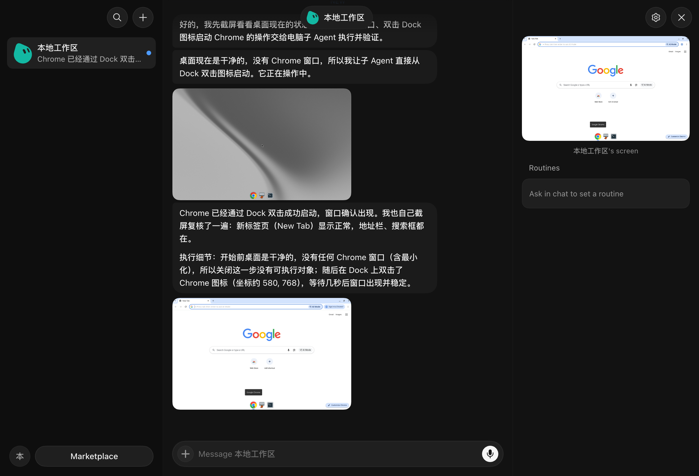
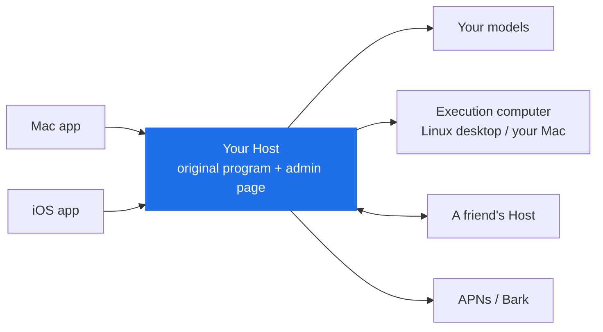
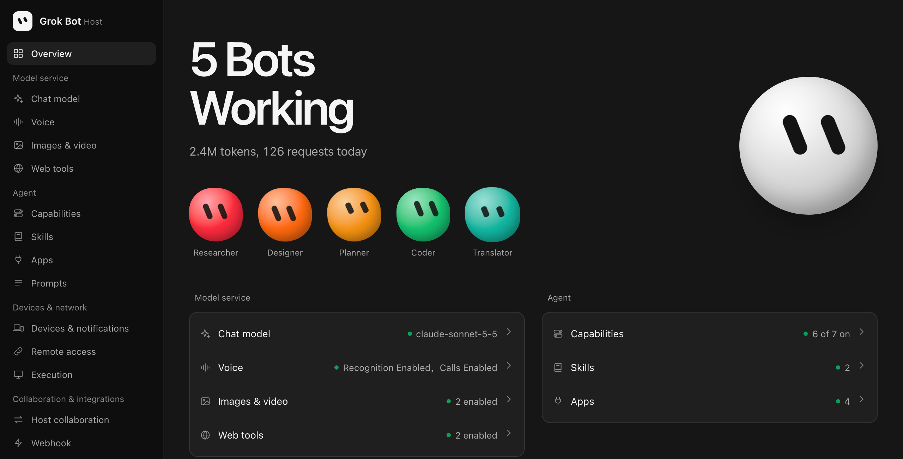

<div align="center">

# ProkBot

**Run the Grok Bot server side on your own machine, with the models you choose.**

Mac · iOS client patches ｜ Host on x86_64 and ARM64 ｜ OpenAI Chat, OpenAI Responses and Anthropic Messages

If you need the web, Android or Windows version, see [ProkBot Plus](https://github.com/ferretgeek/prokbot-plus), a quality fork of this project.

This project was first published by the GitHub account ahaduoduoduo. After that account was suspended, the project moved to the current account, aha-duoduoduo. The Gitee account [ahaduoduoduo](https://gitee.com/ahaduoduoduo) also publishes it: [ahaduoduoduo/ProkBot](https://gitee.com/ahaduoduoduo/ProkBot).

<p>
  
  
  
  
</p>

[简体中文](README.md) · **English**

[What it is](#what-it-is) · [Install](#install) · [Features](#features) · [Server requirements](#server-requirements) · [Client versions](#client-versions) · [Compared with the official app](#compared-with-the-official-app) · [Release notes](RELEASE.en.md)



<sub>The Mac app connected to a self-hosted Host while a Bot works on its Linux desktop.</sub>

</div>

## What it is

Grok Bot is an AI assistant app for Mac, iPhone and other platforms. Its Bots do more than chat: each has its own Linux computer where it runs commands, opens a browser and works with files, along with memory and scheduled tasks. The official apps only connect to the official cloud.

ProkBot moves the server side (the Host and the Bots' Linux computer) onto your own machine with Docker, and patches the official apps you download yourself so they connect to your Host. The models come from your own API.

> This is an unofficial project with no connection to the developer or publisher of Grok Bot, for noncommercial use only. See [License and notices](#license-and-notices).

## Why I built it

I love Grok Bot. Hand it a task and it gets the job done, or at least tries every way it can to get it done.

So I built this project:

1. Run a Host for Grok Bot on your Mac, NAS or server and configure it.
2. Patch the Mac or iOS app so it connects to your Host.
3. Get the same experience as the original, on your own devices and with your own model providers (Grok, Claude, DeepSeek and others).

## What you can do

- **Use the original Grok Bot.** The interface, Agents, tool calls, memory, scheduled tasks and approvals are the original ones; only the server side is yours.
- **Use the models you want.** Claude, GPT, DeepSeek, Grok, or any relay or aggregator gateway. Different Bots can use different models, or the Jev classifier can choose a model by task difficulty.
- **Give the Bot its own computer.** The server comes with a Linux desktop where the Bot runs commands, opens a browser and works with files. Watch it live at any time, or take over.
- **Let the Bot work on your Mac.** The Bot can run commands and use the graphical interface on your Mac, and hand complex coding to Codex on that Mac.
- **Keep your data.** Chats, files, memory and Bot files stay on your machine. Telemetry and automatic updates are turned off.
- **Use it on your phone.** On iPhone and iPad you can chat, get notifications and watch the Bot's computer.
- **Connect from anywhere.** Use your LAN, the built-in Tailcat network (no public IP needed), or your own HTTPS domain.

## How it works

The original Grok Bot runs its server side in the official cloud. It has two main parts: the Host handles conversations, schedules Agents and keeps records, and the cloud computer is a Linux desktop where the Agent actually does its work.

This project runs both parts on your own machines and uses the original programs wherever possible:

- The original Host is patched to use services you configure. It keeps the original Agent task execution, tools and context management.
- The original Linux desktop image runs in Docker. The Agent can also operate a Mac that is online.
- The apps are left almost untouched; the patch only makes them connect to your Host.



This project provides Mac, iOS and Host patch tools. They read the supported official files you supply, verify their digests, and generate the apps and Docker images. Neither the repository nor the patch packages contain official programs.

## Features

🟢 Original kept　🔁 Replaced with your own service　⛔ Turned off

| Feature | Original | Here | You provide |
| --- | --- | --- | --- |
| 🔁 Sign-in | Official account | The Host admin page creates a six-character pairing code; enter the Host address and code in the app to connect | — |
| 🔁 Host and execution computer | Official cloud | Runs wherever you deploy it, using the original Host | A device that can run Docker |
| 🔁 Chat models | Official models with automatic tier selection | You choose the models. Add several model services and set the model, reasoning effort and backup models for all Bots or for one Bot; you can also turn on the Jev classifier to pick the model and effort by task difficulty | A model endpoint and API key: OpenAI Chat Completions, OpenAI Responses or Anthropic Messages |
| 🟢 Computer and browser use | Original Agent | Kept as is | A model with vision |
| 🟢 Memory, context compaction, scheduled tasks | Original Agent, partly backed by official services | Kept, now running on your models with local timers; compaction thresholds are configurable | — |
| 🟢 Approvals, human takeover, input forms | Original | Kept as is | — |
| 🔁 Auto review | Official classification service | Your model decides whether an action may run, and you can write your own allow and block rules | — |
| 🔁 Teach a task | Processed by an official service | Recording is unchanged; your model turns the recording into a skill | A model with vision |
| 🔁 Operating your Mac | Through official services | Through your Host; the Mac doesn't need any open ports | A Mac app generated by the patch and signed |
| 🔁 Bot files and user profile | Official cloud storage and account | Stored on your Host and identical on every device | — |
| 🔁 Skills | Official skill catalog | The Host's own skill catalog, with versions, diffs and restore | — |
| 🔁 Connected apps | Official app marketplace | The Host's own app catalog: import code apps, remote MCP servers or skill-only apps, with OAuth and API key auth. Bots can write apps themselves | Each app's own credentials |
| 🔁 Complex coding | Official cloud coding Agent | Handed to Codex on a connected Mac, using that Mac's Codex sign-in and models | A Mac with Codex CLI installed and signed in |
| 🔁 Sharing Bots and skills | Official publishing platform | Publish to your own Host, export as ZIP, import on another Host | — |
| 🔁 Bots working together | Official service | Hand a task to a Bot on another Host and get the result back in your conversation | Another Host |
| 🔁 Voice input | Official transcription | Fish Audio, any OpenAI-compatible transcription service, or a local model on a Mac | A transcription key or a local model |
| 🔁 Live calls | Official realtime voice model | Speech recognition and speech synthesis each use a service you choose (experimental) | Recognition and synthesis services |
| 🔁 Image and video generation | Official service | Multiple models from multiple providers (currently tested with WaveSpeed) | Provider keys |
| 🔁 Web search | Official search | The model's built-in search or a separately configured search service | Optional |
| 🔁 Push notifications | Official push | APNs when the app is signed with the push entitlement, otherwise Bark | The Bark app, or an Apple Developer account with an APNs key (.p8) |
| 🔁 Remote access | Connects straight to the official cloud | IP address, Tailscale, your own HTTPS reverse proxy, or the built-in Tailcat | A domain, if you need one |
| ⛔ Telemetry and crash reports | Sent to the vendor | Turned off | — |
| ⛔ Automatic updates | Official updates | Turned off; patches are pinned to the supported versions | — |

Disabled: virtual cards, external message drafts, product feedback and passkey forwarding.

### New or improved

| Feature | What it does |
| --- | --- |
| **Apps** | One JSON file is one app. It can include code, a remote MCP server or skills. Code apps run on the execution computer. Bots can also write apps with the built-in "Write an app" tool. See [App development](host/PLUGINS.en.md). |
| **Webhooks** | An external system sends a signed request and a Bot starts working on it. |
| **Usage** | See how many tokens you used each day, on the admin page and in the iOS settings. |
| **Prompt management** | Edit system prompts and restore the original at any time, and see exactly which prompts and tools each role received. |
| **Per-model context** | Set each model's context size and when summarization starts. |
| **Models per Bot** | Each Bot can have its own primary model, reasoning effort and backup models, or turn on the Jev classifier to choose by task difficulty. If the primary fails before any output (quota, rate limit, service error, network), the backups are tried in order. |
| **Manual compaction** | Summarize an idle Bot's context from the admin page. |
| **Web client** | The Host can serve a web interface, on a port of its own, to browsers signed in with a pairing code. The bundle is built from an official installer you download yourself with the [ProkBot Plus](https://github.com/ferretgeek/prokbot-plus/blob/main/web/README.en.md) tools and uploaded on the admin page; nothing changes until one is uploaded. |
| **Admin page** | Configure everything in the browser. It follows the original design and supports Chinese and English, light and dark themes, and phone screens. |
| **Split deployment** | Run the Host and the execution computer on different machines. |
| **Backup and restore** | Back up all data and restore it as a new instance. |
| **Deploy tool** | `host/deploy.py` checks the environment, initializes, builds and starts, upgrades, backs up and restores, one command each. |
| **Command-line admin** | `host/tools/host-admin.mjs` sets up the Host, configures models and creates pairing codes without the web page. |

<div align="center">
  
</div>

## How each part was built

The tools read the supported official files, apply this project's changes, and generate a new app or image.

| Part | Implementation |
| --- | --- |
| **Host** | Reuses the original Host / Harness for task execution, tools, memory and context management. Adds administrator sign-in, pairing, providers and local scheduling. |
| **Models** | Converts requests to OpenAI Chat Completions, OpenAI Responses or Anthropic Messages. The default route and Bot routes set the model, reasoning effort and backup order, and any route can turn on the Jev classifier to choose among three models by task difficulty. |
| **Execution computer** | Runs the original Linux desktop image in Docker, together with the Host or on another machine. The Mac app connects to the Host to provide local operations and Codex coding. |
| **Mac app** | Keeps the original Electron interface and replaces the connection and system integration main process. Apple Silicon and Intel each have their own patch, adding the same code. |
| **iOS app** | Injects a dylib and applies fixed byte patches, keeping the interface, widgets, sharing and notification extensions. Sign the generated IPA with your own certificate. |
| **Realtime voice** | Keeps the original call interface. Speech recognition feeds the current Bot, and speech synthesis reads its reply. Configure providers and voices on the Host; enable the experiment in app settings. |
| **Push and remote access** | The Host sends APNs or Bark notifications. Use a LAN, existing Tailscale / HTTPS setup, or built-in Tailcat without a Tailscale account. |
| **Skills, apps and sharing** | The Host supplies catalogs and authorization through the original marketplace interface. Share apps as JSON and import or export Bots and skills as ZIP. |

See [Features and architecture](docs/ARCHITECTURE.en.md) for more detail.

## Server requirements

The models run at your API provider, so **the server needs no GPU**. It only runs two Docker containers: the Host and the execution computer (a Linux desktop).

| | Minimum | Recommended |
| --- | --- | --- |
| CPU | 2 cores | 4 cores or more |
| Memory | 4 GB | 8 GB or more |
| Free disk space | 30 GB | 50 GB or more |
| System | A 64-bit system with Docker Compose v2 and Python 3.10+ | x86_64 Linux (tested on Ubuntu 24.04 with Docker 29) |

This is enough for one person or a household. Heavy use by many people at once has not been tested. These figures come from [ProkBot Plus](https://github.com/ferretgeek/prokbot-plus) test runs on x86_64 Linux:

- **2 cores and 2 GB is not enough.** Both test runs failed to finish a series of chats in time, and the background model connection dropped and the core restarted.
- **2 cores / 4 GB and 4 cores / 8 GB both work.** Each was deployed from scratch and completed pairing, an attachment upload, several real chats and a cancellation; after a restart, chats and settings were all still there. A build from scratch takes about 9–10 minutes, depending on network speed.
- **Actual usage.** On a server with 6 cores and 16 GB, running for about a week, the Host used about 0.7 GB of memory (peak 0.9 GB) and the execution computer about 0.8 GB (peak 1.7 GB). The images take about 13 GB of disk. Chat and file data start under 100 MB and grow with use.
- The first deployment downloads the official files and base images from the internet, and the build needs extra temporary space. Backups also take space.

| Your machines | Notes |
| --- | --- |
| One x86_64 Linux machine | **Recommended.** The Host and the execution computer run on the same machine; the figures above were measured this way. |
| ARM64 Linux + x86_64 Linux | The Host runs on the ARM machine and the execution computer on the x86_64 machine (the execution computer only exists for amd64). See [split deployment](host/docs/DEPLOYMENT.en.md). Chat and the remote desktop were tested on an Oracle Ampere A1 earlier; the current version has not been retested there. |
| ARM only (ARM64 Linux, Apple Silicon Mac) | The execution computer runs under emulation and is clearly slower; `python3 host/deploy.py doctor` checks whether it can run first. Docker Desktop on Apple Silicon Macs has not been tested. |
| A NAS | Anything that runs Docker Compose v2; match its CPU architecture to the rows above. The maintainer's own Host runs daily on an x86_64 Synology DSM. |

## What else you need

| Required | Details |
| --- | --- |
| Machine | A computer or NAS that runs Docker Compose v2; see [server requirements](#server-requirements). The Host image is built for the Docker machine's architecture (amd64 or arm64); the Linux desktop image is amd64 only and runs under emulation on ARM machines. |
| Model API | Any one of three formats: OpenAI Chat Completions, OpenAI Responses or Anthropic Messages. The model must support tool calls, and image input if the Bot should operate a computer. |
| A computer to generate the apps | The Mac app is generated on a Mac (Apple Silicon or Intel) with Node.js 22.12+. For iPhone and iPad you supply your own decrypted IPA and signing certificate. |
| Official installers | The patches only modify official versions you download yourself; see [client versions](#client-versions). This project does not distribute official programs. |
| Software | Python 3.10+ and Docker Compose v2. |

| Optional | Used for |
| --- | --- |
| A model with built-in web search, or a separate search service | Searching and reading web pages |
| An image or video API | Generating images and videos |
| Speech recognition and speech synthesis services | Voice input and live calls |
| Bark or an Apple push certificate | iPhone notifications |
| A domain with HTTPS | Remote access without Tailcat |

## Client versions

The patches accept only the versions below and never update themselves. The latest official releases were checked on 2026-11-19; when they are newer than the version this project needs, wait until this project supports them.

| Platform | Latest official | Version this project needs | How to get it | Testing |
| --- | --- | --- | --- | --- |
| macOS (Apple Silicon, Intel) | 1.2.3 | 0.71.2 | `mac/patchers/desktop/patch.mjs` downloads and verifies the official version for this Mac's chip | Tested on Apple Silicon hardware: pairing, chats, reconnection and attachments. A user tested generation, pairing and chats on an Intel Mac with macOS 15.7 |
| iOS / iPadOS | 1.26.0 | 1.16.0 (build 23152) | Supply your own decrypted IPA, inject `GrokBotLocal.dylib` from the [releases page](https://github.com/aha-duoduoduo/ProkBot/releases) and apply the byte patches with `ios/release/patch-ios.py`, then sign it with your own certificate; or use the patched unsigned IPA on the [Gitee release](https://gitee.com/ahaduoduoduo/ProkBot/releases/tag/v2026.11.02) | Tested on iPhone 11 and iPhone Air |
| Linux server | n/a | Host `d0a4baa`; execution computer `9d2ac1b` (amd64) | The build tools download and verify them | Daily use on an x86_64 Synology DSM; tested from scratch on Ubuntu 24.04 |

For the web, Android and Windows clients, see [ProkBot Plus](https://github.com/ferretgeek/prokbot-plus/blob/main/README.en.md#client-versions).

## Install

The easiest way: give the following to an AI that can run commands (Claude Code, Codex, Cursor and so on), using the copy button at the top right of the code block:

```text
Help me install and configure ProkBot:
https://github.com/aha-duoduoduo/ProkBot
Read README.en.md and docs/AI-INSTALL.en.md, then carry out the deployment and configuration.
Ask me for the deployment target, clients, access method and model configuration together.
Verify the Host and client connections, then give me the access URL and maintenance commands.
```

To do it yourself, follow the [installation guide](docs/INSTALL.en.md). On the server the steps are `doctor` (check the environment) → `init` (create the configuration) → `up` (build and start) → `status`; then set up a model and create a pairing code on the admin page, and connect from the app.

Downloads: each version on the [releases page](https://github.com/aha-duoduoduo/ProkBot/releases) provides the Host and Mac patch packages, the iOS injection library `GrokBotLocal.dylib`, and `manifest.json` and `SHA256SUMS` checksum files. The packages contain no official programs and no patched apps; you generate the apps on your own computer with the patch tools.

For iOS, supply your own decrypted 1.16.0 (23152) IPA, inject `GrokBotLocal.dylib` with `ios/release/patch-ios.py`, then sign it with your own certificate. The `GrokBotLocal.dylib` on the releases page is the same file as the one in `ios/bin/`, and the patch tool checks its digest. Injecting the dylib alone is not enough: the patch tool also applies fixed byte patches, so always generate the app with it. The patched unsigned IPA is also available on the [Gitee v2026.11.02 release](https://gitee.com/ahaduoduoduo/ProkBot/releases/tag/v2026.11.02).

## Compared with the official app

**Benefits**

- Choose your own models and providers, billed through your own API; relays and aggregator gateways work too, and different Bots can use different models.
- Chats, files and memory stay on your own server, with no telemetry.
- No dependency on the official cloud; it even works on a LAN alone.
- Some extras the official version doesn't have: editing the system prompt (the original can be restored at any time), context length per model, usage statistics, tasks triggered by webhooks, your own apps, Bot collaboration across several Hosts, and data backup and restore.

**Trade-offs**

- You need a machine that runs Docker, and you do upgrades and backups yourself.
- Versions are pinned: the Mac app at 0.71.2 and iOS at 1.16.0 (see [client versions](#client-versions)). When the official apps update, you have to wait for this project to support them; there are no automatic updates.
- Results depend on the model you choose. The official service is tuned for its own models, so other models may feel different.
- Some official features are turned off or replaced: virtual cards, external message drafts, product feedback and passkey forwarding are off; voice, push and image/video generation need providers you set up yourself; real-time voice calls are experimental.
- You sign the apps yourself: the Mac app is ad-hoc signed by default and needs your own certificate before a Bot can operate that Mac; on iPhone and iPad you sign and install with your own certificate.
- Modifying the official apps may violate the official terms of use. Use at your own risk.

## Documentation

| Document | Contents |
| --- | --- |
| [Installation guide](docs/INSTALL.en.md) | Deploying the Host and generating the Mac and iOS apps |
| [AI deployment guide](docs/AI-INSTALL.en.md) | Complete deployment steps written for an AI, with commands and checks for each step; people can follow it too |
| [Features and architecture](docs/ARCHITECTURE.en.md) | How each feature works, the directory layout and known limits |
| [Host deployment and backups](host/docs/DEPLOYMENT.en.md) | Deployment options, the web client port, memory reading, backup and restore |
| [App development](host/PLUGINS.en.md) | Writing and sharing apps |
| [Release notes](RELEASE.en.md) | Changes in each version |

## License and notices

- This project uses the [ProkBot Noncommercial License 1.0](LICENSE): you may use it personally, study it, modify it and share it noncommercially. It may not be used for any commercial purpose, including paid deployments, paid services and internal business use.
- The repository and the patch packages contain no official Grok Bot programs or resources. The Mac and Host patches only read official versions you download yourself, after checking their digests; for iOS you supply your own decrypted IPA. The patches contain only this project's code and fixed modification rules.
- Grok, Grok Bot and related trademarks belong to their respective owners. This project is not affiliated with or endorsed by their developer or publisher.
- Modifying the official apps may violate the official terms of use. Use at your own risk.
- Most of the code was written with AI assistance and is provided as is, without warranty.
- Issues, suggestions and contributions are welcome.

<sub>Built for friends who cannot use Grok Bot.</sub>
