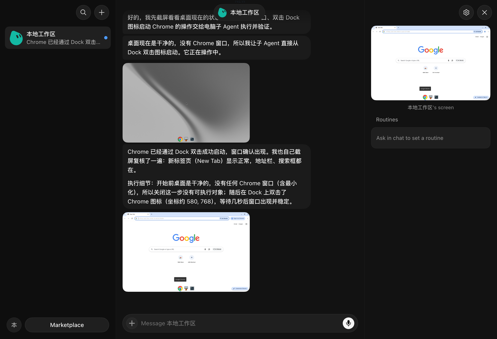
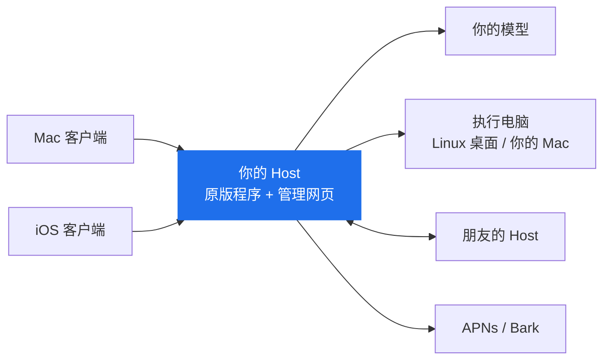
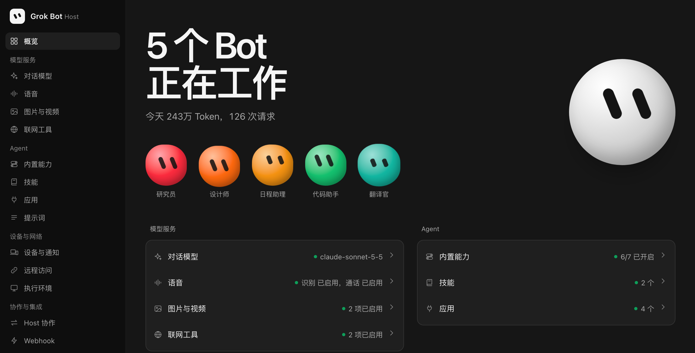

<div align="center">

# ProkBot

**在自己的机器上运行 Grok Bot 的服务端，用你自己选的模型。**

Mac · iOS 客户端补丁 ｜ Host 支持 x86_64 和 ARM64 ｜ 支持 OpenAI Chat、OpenAI Responses、Anthropic Messages 三种接口

如果您需要网页版/Android/Windows 版本，可查看本项目的优质 fork 实现 [ProkBot Plus](https://github.com/ferretgeek/prokbot-plus)。

本项目原先由 GitHub 账号 ahaduoduoduo 发布。该账号被停用后，项目转到当前账号 aha-duoduoduo 继续维护。Gitee 账号 [ahaduoduoduo](https://gitee.com/ahaduoduoduo) 同步发布本项目：[ahaduoduoduo/ProkBot](https://gitee.com/ahaduoduoduo/ProkBot)。

<p>
  
  
  
  
</p>

**简体中文** · [English](README.en.md)

[这是什么](#这是什么) · [安装](#安装) · [功能对照](#功能对照) · [服务器要求](#服务器要求) · [客户端版本](#客户端版本) · [和官方版比较](#和官方版比较) · [发布说明](RELEASE.md)



<sub>Mac 客户端连接自己部署的 Host，Bot 正在操作它的 Linux 桌面。</sub>

</div>

## 这是什么

Grok Bot 是一款 AI 助手应用，有 Mac、iPhone 等客户端。它的 Bot 不只会聊天：有自己的一台 Linux 电脑，能跑命令、开浏览器、处理文件，还有记忆和定时任务。但原版只能连官方云端。

ProkBot 用 Docker 把服务端（Host 和 Bot 用的 Linux 电脑）搬到你自己的机器上，再给你自己下载的官方客户端打补丁，让它连到你的 Host。模型用你自己的接口。

> 这是非官方项目，与 Grok Bot 的开发方和发行方没有任何关系，仅限非商业使用，见[许可与声明](#许可与声明)。

## 为什么做这个

我很喜欢 Grok Bot，交给它一件事，它会帮你干好，或者说，想尽办法帮你做好。

所以我做了这个项目：

1. 在你的 Mac、NAS 或服务器上运行一个给 Grok Bot 用的 Host，并完成配置。
2. 用补丁生成 Mac 或 iOS 客户端，让它连到你的 Host。
3. 体验和原版一样，但用的是你自己的设备和推理服务（Grok、Claude、DeepSeek 等）。

## 能做什么

- **用原版 Grok Bot。** 界面、Agent、工具调用、记忆、定时任务、操作审批都是原版的，只是服务端在你自己手里。
- **接你想用的模型。** Claude、GPT、DeepSeek、Grok，或各种中转、聚合网关都可以。不同的 Bot 可以用不同的模型，也可以让 Jev 分类器按任务难度选模型。
- **Bot 有自己的电脑。** 服务端自带一台 Linux 桌面，Bot 在上面跑命令、开浏览器、处理文件。你可以随时看实时画面，也可以接手操作。
- **让 Bot 操作你的 Mac。** Bot 可以在你的 Mac 上执行命令、操作图形界面，复杂编程交给这台 Mac 上的 Codex。
- **数据留在自己手里。** 对话、文件、记忆、Bot 资料都存在你的机器上，遥测和自动更新已关闭。
- **手机上也能用。** iPhone 和 iPad 可以聊天、收通知、看 Bot 电脑的画面。
- **在外面也能连。** 局域网直连、内置的 Tailcat 组网（不需要公网 IP），或者你自己的 HTTPS 域名。

## 原理

原版 Grok Bot 的服务端在官方云端，主要有两部分：Host 负责对话、调度 Agent 和保存记录；云电脑是一台 Linux 桌面，Agent 在上面实际操作。

这个项目把这两部分都放到你自己的机器上，尽量直接使用原版程序：

- 给原版 Host 打补丁，让它使用你自己配置的服务，保留原版 Agent 的任务执行、工具调用和上下文管理。
- 原版 Linux 桌面镜像运行在 Docker 里。Agent 也可以直接操作一台在线的 Mac。
- 客户端几乎保持不变，补丁只让它连到你的 Host。



本项目提供 Mac、iOS、Host 三个补丁工具。它们读取你提供的指定版本官方文件，校验摘要后生成客户端和 Docker 镜像；仓库和补丁包里都不含官方程序。

## 功能对照

🟢 保留原版　🔁 换成你自己的服务　⛔ 已关闭

| 功能 | 原版 | 这里 | 你需要准备 |
| --- | --- | --- | --- |
| 🔁 登录 | 官方账号 | Host 管理页生成六位配对码，客户端输入 Host 地址和配对码即可连接 | — |
| 🔁 Host 和执行电脑 | 官方云端 | 运行在你部署的位置，使用原版 Host | 一台能运行 Docker 的设备 |
| 🔁 对话模型 | 官方模型，自动选择等级 | 自行决定模型。可添加多个模型服务，给所有 Bot 或单个 Bot 指定模型、思考强度和备用模型；也可以打开 Jev 分类器，按任务难度自动选择模型和思考强度 | 模型接口的地址和 API Key，支持 OpenAI Chat Completions、OpenAI Responses、Anthropic Messages |
| 🟢 电脑和浏览器操作 | 原版 Agent | 保留原版 | 支持视觉能力的模型 |
| 🟢 记忆、上下文压缩、定时任务 | 原版 Agent，部分依赖官方服务 | 保留原版，改用你的模型和本地计时，上下文压缩可自行设置 | — |
| 🟢 操作审批、人工接管、交互表单 | 原版 | 保留原版 | — |
| 🔁 自动审查 | 官方分类服务 | 用你的模型判断操作能不能执行，允许和阻止规则可以自己写 | — |
| 🔁 演示任务（Teach a task） | 官方服务整理 | 录制保留原版，整理成技能用你的模型 | 支持视觉能力的模型 |
| 🔁 操作你的 Mac | 经官方服务 | 经你的 Host，Mac 不需要开放端口 | 补丁生成并签名的 Mac 客户端 |
| 🔁 Bot 资料库、用户资料 | 官方云存储和账号 | 保存在 Host 上，所有设备看到的一样 | — |
| 🔁 技能 | 官方技能目录 | Host 自己的技能目录，可以查看版本、对比和恢复 | — |
| 🔁 连接应用 | 官方应用市场 | Host 自己的应用目录，可以导入代码应用、远程 MCP 或纯技能，支持 OAuth、API Key 授权；Bot 也能自己编写应用 | 应用自己的凭据 |
| 🔁 复杂编程 | 官方云端编程 Agent | 交给已连接 Mac 上的 Codex，使用这台 Mac 的 Codex 登录和模型 | 安装并登录 Codex CLI 的 Mac |
| 🔁 Bot 和技能分享 | 官方发布平台 | 发布到自己的 Host，可导出 ZIP，在别的 Host 导入 | — |
| 🔁 多个 Bot 协作 | 官方服务 | 把任务交给其他 Host 上的 Bot，结果回到你的对话 | 另一个 Host |
| 🔁 语音输入 | 官方转写 | Fish Audio、OpenAI 兼容的转写服务，或 Mac 上的本地模型 | 转写服务的 Key 或本地模型 |
| 🔁 实时通话 | 官方实时语音模型 | 识别和合成分别接你选的服务（实验功能） | 识别和合成服务 |
| 🔁 图片和视频生成 | 官方服务 | 多个供应商的多个模型（目前测试 Wavespeed） | 供应商的 Key |
| 🔁 联网搜索 | 官方搜索 | 用模型自带的搜索，或单独配置搜索服务 | 可选 |
| 🔁 手机推送 | 官方推送 | 安装包签名带推送权限时用 APNs，否则用 Bark | Bark App，或 Apple 开发者账号和 APNs 密钥（.p8） |
| 🔁 外网访问 | 直接连官方云端 | IP 地址、Tailscale 组网、自定义 HTTPS 反向代理，或内置的 Tailcat | 视情况准备域名 |
| ⛔ 遥测和错误上报 | 发给官方 | 已关闭 | — |
| ⛔ 自动更新 | 官方更新 | 已关闭，补丁固定在支持的版本 | — |

已关闭：虚拟卡、外部消息草稿、产品反馈与通行密钥转发。

### 新增或增强功能

| 功能 | 说明 |
| --- | --- |
| **应用** | 一个 JSON 文件就是一个应用，可以带代码、远程 MCP 服务或技能。代码应用运行在执行电脑上。Bot 也可以用内置的“编写应用”自己写应用。见[应用开发](host/PLUGINS.md)。 |
| **Webhook** | 外部系统发一个签名请求，Bot 就开始执行任务。 |
| **用量统计** | 每天用了多少 Token，在管理页和 iOS 设置里都能看到。 |
| **提示词管理** | 可以修改系统提示词并随时恢复原版，还能看到每个角色实际收到的提示词和工具。 |
| **按模型设置上下文** | 每个模型的容量和开始摘要的时机可以单独设置。 |
| **按 Bot 选模型** | 每个 Bot 可以有自己的主模型、思考强度和备用模型，也可以打开 Jev 分类器按任务难度选择。主模型还没输出时出错（额度、限流、服务故障、网络），按顺序换备用模型。 |
| **手动压缩上下文** | 在管理页把空闲 Bot 的上下文压缩成摘要。 |
| **网页版** | Host 可以向用配对码登录的浏览器提供网页版界面，使用单独的端口。界面包用 [ProkBot Plus](https://github.com/ferretgeek/prokbot-plus/blob/main/web/README.md) 的工具从你自己下载的官方安装包生成，再在管理页上传；不上传就没有变化。 |
| **管理网页** | 所有设置都在浏览器里完成，沿用原版的设计风格，支持中英文、深浅色和手机屏幕。 |
| **分开部署** | Host 和执行电脑可以放在不同的机器上。 |
| **备份恢复** | 备份全部数据，恢复成一个新的实例。 |
| **部署工具** | `host/deploy.py` 用一个命令完成环境检查、初始化、构建启动、升级、备份和恢复。 |
| **命令行管理** | `host/tools/host-admin.mjs` 不打开网页也能初始化、配置模型、生成配对码。 |

<div align="center">
  
</div>

## 每个部分是怎么做的

补丁从指定版本的官方文件中读取内容，加入本项目的修改，生成新的客户端或镜像。

| 部分 | 实现方式 |
| --- | --- |
| **Host** | 复用原 Host / Harness 的任务执行、工具、记忆和上下文管理，补充管理员登录、设备配对、供应商配置与本地定时触发。 |
| **模型** | 将原模型请求转换为 OpenAI Chat Completions、OpenAI Responses 或 Anthropic Messages 格式。默认路由和 Bot 路由指定模型、思考强度和备用顺序；每条路由都可以打开 Jev 分类器，按任务难度在三档模型之间选择。 |
| **执行电脑** | 原 Linux 桌面镜像运行在 Docker 中，可以与 Host 分开部署。Mac 客户端主动连接 Host，提供本机操作与 Codex 编程。 |
| **Mac 客户端** | 保留 Electron 原界面，替换连接和系统功能的主进程，接入自己的 Host。Apple Silicon 和 Intel 各有一套补丁，加入的代码相同。 |
| **iOS 客户端** | 注入 dylib 并应用固定字节补丁，保留原界面、小组件、分享和通知扩展。生成的 IPA 用你自己的证书签名安装。 |
| **实时语音** | 保留原通话界面；识别服务将语音转成文字，由当前 Bot 回答，再由合成服务朗读。供应商和音色在 Host 配置，实验开关在客户端设置。 |
| **推送与远程访问** | Host 发送 APNs 或 Bark 通知。可使用局域网、已有的 Tailscale / HTTPS，也可启用内置 Tailcat，无需 Tailscale 账号。 |
| **技能、应用与分享** | 目录和授权由 Host 提供，客户端沿用原市场界面。应用通过 JSON 分享，Bot 与技能通过 ZIP 导入导出。 |

更完整的说明见[功能与原理](docs/ARCHITECTURE.md)。

## 服务器要求

模型推理走 API，在模型服务商那边，**服务器不需要显卡**。服务器只运行两个 Docker 容器：Host 和执行电脑（Linux 桌面）。

| | 最低 | 推荐 |
| --- | --- | --- |
| CPU | 2 核 | 4 核或更多 |
| 内存 | 4 GB | 8 GB 或更多 |
| 硬盘可用空间 | 30 GB | 50 GB 或更多 |
| 系统 | 64 位系统，Docker Compose v2，Python 3.10+ | x86_64 Linux（实测环境为 Ubuntu 24.04 + Docker 29） |

这个配置适合一个人或一家人日常使用；多人同时高强度使用还没有测过。以下数据来自 [ProkBot Plus](https://github.com/ferretgeek/prokbot-plus) 在 x86_64 Linux 上的实测：

- **2 核 2 GB 不够用。** 实测两次都没能按时完成连续对话，还出现过后台断连、核心重启。
- **2 核 4 GB、4 核 8 GB 都实测可用。** 各自从零部署，完成了配对、上传附件、多轮真实对话、中途取消，重启后对话和设置都还在。从零构建大约要 9～10 分钟（视网速而定）。
- **实际占用。** 一台 6 核 16 GB 的服务器连续运行约一周：Host 平时约 0.7 GB 内存，最高 0.9 GB；执行电脑平时约 0.8 GB，最高 1.7 GB。镜像约占 13 GB 硬盘，对话和文件数据刚开始不到 100 MB，会随使用增长。
- 首次部署要从网上下载官方文件和基础镜像（国内网络可能需要代理），构建时还要额外的临时空间；备份也另占空间。

| 你的机器 | 说明 |
| --- | --- |
| 一台 x86_64 Linux | **推荐。** Host 和执行电脑装在同一台机器上，上面的数据都是这种方式测得的。 |
| ARM64 Linux + x86_64 Linux | Host 装在 ARM 机器上，执行电脑装在 x86_64 机器上（执行电脑只有 amd64 版本），见[分开部署](host/docs/DEPLOYMENT.md)。以往在甲骨文 Ampere A1 上测过对话和远程桌面，当前版本还没有重新测过。 |
| 只有 ARM 机器（ARM64 Linux、Apple Silicon Mac） | 执行电脑通过转译运行，明显更慢；`python3 host/deploy.py doctor` 会先检查能不能运行。Apple Silicon Mac 上的 Docker Desktop 没有测过。 |
| NAS | 能运行 Docker Compose v2 即可，按 CPU 架构对照上面几行。维护者的 Host 日常运行在 x86_64 的群晖 DSM 上。 |

## 还需要准备什么

| 必需 | 说明 |
| --- | --- |
| 机器 | 能运行 Docker Compose v2 的电脑或 NAS，配置见[服务器要求](#服务器要求)。Host 镜像按 Docker 所在机器的架构构建（amd64 或 arm64）；Linux 桌面镜像只有 amd64，在 ARM 机器上通过转译运行。 |
| 模型接口 | 三种格式任选一种：OpenAI Chat Completions、OpenAI Responses、Anthropic Messages。模型要支持工具调用；想让 Bot 操作电脑，还要能看图片。 |
| 生成客户端的电脑 | Mac 客户端在 Mac 上生成（Apple Silicon 或 Intel），需要 Node.js 22.12+。iPhone / iPad 需要你自备已解密的 IPA 和签名证书。 |
| 官方安装包 | 补丁只改你自己下载的官方版本，版本见下面的[客户端版本](#客户端版本)。本项目不分发官方程序。 |
| 软件 | Python 3.10+、Docker Compose v2。 |

| 可选 | 用途 |
| --- | --- |
| 支持原生联网的模型，或单独的搜索服务 | 让 Bot 搜索、读网页 |
| 图片、视频接口 | 让 Bot 生图、生视频 |
| 语音识别和语音合成服务 | 语音输入、实时通话 |
| Bark 或 Apple 推送证书 | iPhone 推送 |
| 域名和 HTTPS | 不用 Tailcat 时从外网访问 |

## 客户端版本

补丁只认下面这些版本，不会自动更新。官方最新版是 2026-11-19 核对的，比“需要的版本”新时，要等本项目适配。

| 平台 | 官方最新版 | 本项目需要的版本 | 怎么获得 | 测试情况 |
| --- | --- | --- | --- | --- |
| macOS（Apple Silicon、Intel） | 1.2.3 | 0.71.2 | `mac/patchers/desktop/patch.mjs` 按本机芯片自动下载并校验官方版本 | Apple Silicon 真机实测配对、对话、断线重连和附件；Intel 由用户在 macOS 15.7 上实测生成、配对和多轮对话 |
| iOS / iPadOS | 1.26.0 | 1.16.0（构建 23152） | 自备已解密的 IPA，用 `ios/release/patch-ios.py` 注入[发行页](https://github.com/aha-duoduoduo/ProkBot/releases)的 `GrokBotLocal.dylib` 并应用字节补丁，再用自己的证书签名安装；也可以直接用 [Gitee 发行页](https://gitee.com/ahaduoduoduo/ProkBot/releases/tag/v2026.11.02)已注入补丁的未签名 IPA | iPhone 11、iPhone Air 真机实测 |
| Linux 服务端 | 不适用 | Host `d0a4baa`；执行电脑 `9d2ac1b`（amd64） | 构建工具自动下载并校验 | x86_64 群晖 DSM 日常使用；Ubuntu 24.04 从零部署实测 |

网页版、Android 和 Windows 客户端见 [ProkBot Plus](https://github.com/ferretgeek/prokbot-plus#client-versions)。

## 安装

最省事的方法：交给一个能执行命令的 AI（Claude Code、Codex、Cursor 等都行），把下面这段发给它，点击代码框右上角即可复制：

```text
请帮我安装并配置 ProkBot：
https://github.com/aha-duoduoduo/ProkBot
先阅读 README.md 和 docs/AI-INSTALL.md，按指南实际完成部署与配置。
需要我提供的部署位置、客户端、访问方式和模型信息，请一次问清。
完成后验证 Host 和客户端连接，告诉我使用入口及日常维护命令。
```

想自己动手，就照着[安装说明](docs/INSTALL.md)做。服务端的流程是：`doctor`（检查环境）→ `init`（生成配置）→ `up`（构建并启动）→ `status`（查看状态），然后在管理页填模型、生成配对码，用客户端连接。

下载：[发行页](https://github.com/aha-duoduoduo/ProkBot/releases)按版本提供 Host 和 Mac 补丁包、iOS 注入库 `GrokBotLocal.dylib`，以及 `manifest.json`、`SHA256SUMS` 校验文件。补丁包里没有官方程序，也没有打好补丁的客户端，客户端要用补丁工具在你自己的电脑上生成。

iOS 需要自备已解密的 1.16.0（23152）IPA，用 `ios/release/patch-ios.py` 注入 `GrokBotLocal.dylib`，再用自己的证书签名安装。发行页的 `GrokBotLocal.dylib` 和仓库 `ios/bin/` 里的是同一个文件，补丁工具会核对它的摘要。只注入 dylib 不够，补丁工具还会应用固定的字节补丁，一定要用它生成。已经注入补丁的未签名 IPA 也可以在 [Gitee v2026.11.02 发行页](https://gitee.com/ahaduoduoduo/ProkBot/releases/tag/v2026.11.02)下载。

## 和官方版比较

**好处**

- 模型和服务商自己选，按你自己的接口计费，也可以用中转或聚合网关；不同的 Bot 可以用不同的模型。
- 对话、文件、记忆都在自己的服务器上，没有遥测。
- 不依赖官方云端，只在局域网里用也行。
- 多了一些官方没有的功能：修改系统提示词（随时能恢复原版）、按模型设置上下文长度、用量统计、Webhook 触发任务、自己写应用、多台 Host 之间的 Bot 协作、数据备份与恢复。

**代价**

- 要有一台能运行 Docker 的机器，升级和备份要自己做。
- 版本是固定的：Mac 客户端 0.71.2，iOS 1.16.0（见[客户端版本](#客户端版本)）。官方出新版后，要等本项目适配才能升级，没有自动更新。
- 效果取决于你选的模型。官方针对自家模型做过调校，换别的模型体验可能有差距。
- 部分官方功能关掉或换掉了：虚拟卡、外部消息草稿、产品反馈、通行密钥转发已关闭；语音、推送、生图视频要自己准备服务商；实时语音通话还是实验功能。
- 客户端要自己签名：Mac 客户端默认 ad-hoc 签名，想让 Bot 操作这台 Mac 需要用自己的证书签名；iPhone / iPad 用自己的证书签名安装。
- 修改官方客户端可能违反官方用户条款，风险自负。

## 文档

| 文档 | 内容 |
| --- | --- |
| [安装说明](docs/INSTALL.md) | 部署 Host、生成 Mac 和 iOS 客户端的步骤 |
| [AI 部署手册](docs/AI-INSTALL.md) | 写给 AI 的完整部署步骤，每一步都有命令和检查方法，人照着做也没问题 |
| [功能与原理](docs/ARCHITECTURE.md) | 每个功能的实现、目录结构和已知限制 |
| [Host 部署与备份](host/docs/DEPLOYMENT.md) | 部署方式、网页版端口、Bot 读记忆、备份与恢复 |
| [应用开发](host/PLUGINS.md) | 编写和分享应用 |
| [发布说明](RELEASE.md) | 每个版本的改动 |

## 许可与声明

- 本项目使用 [ProkBot 非商业许可证 1.0](LICENSE)：可以个人使用、学习、修改和非商业分发；不能用于任何商业用途，包括收费部署、付费服务和企业内部使用。
- 仓库和补丁包里没有任何 Grok Bot 官方程序或资源。Mac 和 Host 的补丁只读取你自己下载并经过摘要校验的官方版本；iOS 需要你自备已解密的 IPA。补丁只包含本项目的代码和固定的修改规则。
- Grok、Grok Bot 及相关商标归各自权利人所有。本项目与它们的开发方和发行方没有关联，也没有得到其认可。
- 修改官方客户端可能违反官方用户条款，风险自负。
- 本项目大部分代码由 AI 辅助编写，按现状提供，不提供任何担保。
- 欢迎提问题、提建议和提交代码。

<sub>为了那些用不了 Grok Bot 的朋友而做。</sub>
